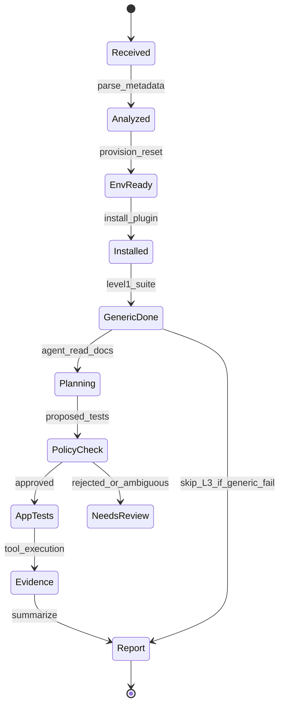
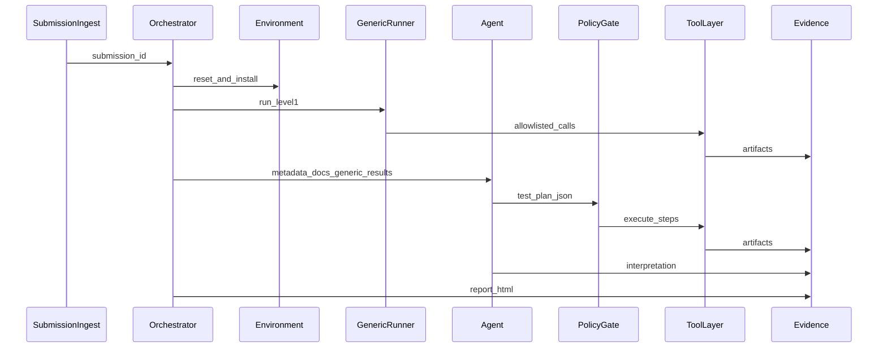

# Architecture

## Components

| Component | Responsibility |
|-----------|----------------|
| **Submission ingest** | Accept submission bundle or API payload; persist `submission_id` |
| **Submission analyzer** | Parse metadata; select host version, VM template, generic suite ID |
| **Test orchestrator** | State machine for run lifecycle; invokes runners and agent |
| **Environment controller** | VM snapshot, install, reset, Plant 3D lifecycle |
| **Generic test runner** | Level 1 pytest (or equivalent) calling tool layer only |
| **Test agent** | LLM: plan + interpret; no direct UI control |
| **Policy gate** | Validates agent plans (tools, paths, dataset IDs) |
| **Tool layer** | `execute_tool(name, args)` → deterministic implementation |
| **Test data repository** | Catalogues DWGs, projects, expected outputs |
| **Evidence store** | Artifacts per run |
| **Report builder** | HTML/PDF for reviewers |

MCP may wrap the tool layer later; PoC starts with an internal Python facade.

## Run lifecycle



## Sequence (happy path)



## Integration modes

| Mode | PoC | Production target |
|------|-----|-------------------|
| Trigger | CLI / folder watch / `POST /runs` | Internal submission queue or webhook |
| Package | Local path in submission folder | Signed URL from marketplace backend |
| Environment | Single Windows VM + snapshot | Pool of versioned templates |

## AI agent boundaries

**In scope:** Read submission docs; propose structured test plans; choose catalogue datasets; call allow-listed tools; summarize evidence.

**Out of scope:** Direct keyboard/mouse; inventing test files; calling tools not in SPEC; final certification verdict without human policy.

## Reference diagram (logical)

```text
Submission → Analyzer → Orchestrator → Agent
                              ↓
                    Environment + Tool layer
                              ↓
                    Plant 3D + submitted plugin
                              ↓
                    Evidence → Report → Human reviewer
```
